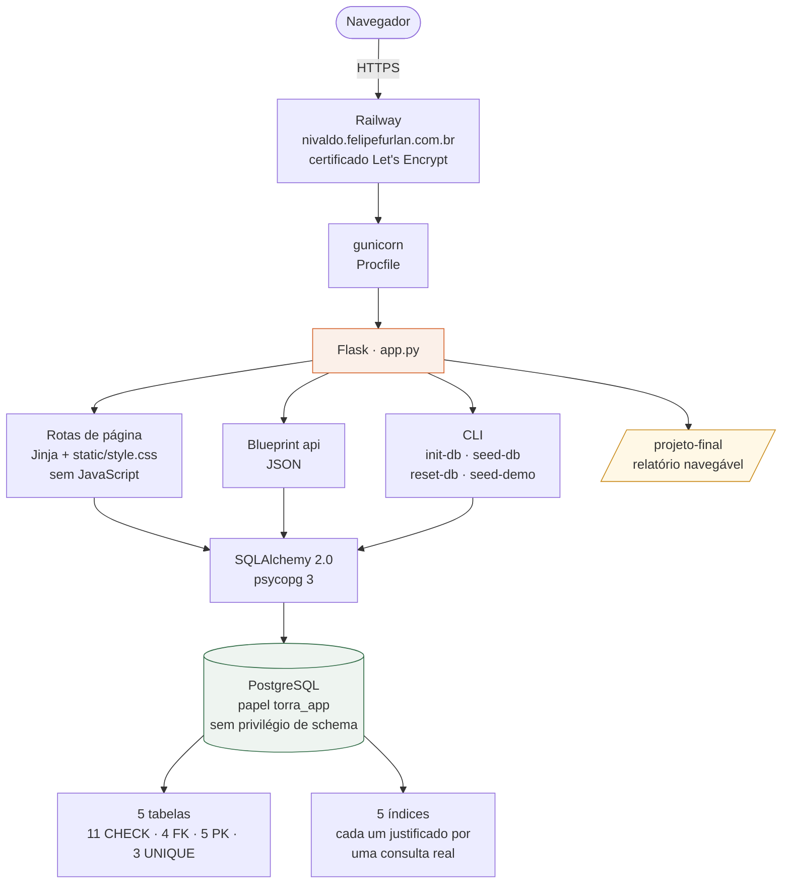

# Torra &amp; Terra

**E-commerce de café especial em Flask + PostgreSQL.**
Projeto Final da disciplina **Tratamento e Armazenamento da Informação** —
FACAMP, Prof. Me. Nivaldo T. Marcusso.
Grupo 3: Felipe Furlan · Henrique Biruel · Henrique Palorca.

| | |
|---|---|
| **Loja no ar** | https://nivaldo.felipefurlan.com.br |
| **Painel do gestor** | https://nivaldo.felipefurlan.com.br/painel |
| **Relatório navegável** | https://nivaldo.felipefurlan.com.br/projeto-final |
| **Health check** | https://nivaldo.felipefurlan.com.br/health |
| **Repositório** | https://github.com/hick12/projeto-nivaldo |


---

## Objetivo

A loja é o pretexto. O que o projeto demonstra é **modelagem relacional,
constraints no banco, transação atômica, indicadores lidos do banco e
deploy em nuvem**.

Uma torrefação de cafés especiais vende hoje por telefone, WhatsApp e
planilha. Daí nascem duas falhas que se repetem: **o mesmo lote vendido
duas vezes**, porque duas vendas aconteceram em paralelo e ninguém baixou
o saldo a tempo, e **o pedido registrado pela metade**, em que o cabeçalho
existe mas os itens não, ou o total não corresponde aos itens.

O objetivo do MVP é fechar toda venda de forma completa e consistente, com
a integridade garantida pelo **banco de dados** — não pela boa vontade de
quem digita.

**Segmento 1 — Varejo** · Contexto: **carrinho, pedidos e pagamentos** ·
Processo: venda transacional · Dor: falhas de confirmação e de conciliação.

**Por que PostgreSQL:** o checkout precisa de transação ACID, integridade
referencial e controle de concorrência (`SELECT ... FOR UPDATE`). As regras
de negócio ficam no próprio banco, como constraints.

**Por que café especial:** cada item do pedido carrega a **moagem**
escolhida na compra — grão, média ou fina. É um atributo que existe só no
item, nunca no produto. É o que faz `itens_pedido` ser uma entidade de
verdade, e não uma tabela de ligação.

---

## Arquitetura



Monólito servido pelo servidor, sem camada intermediária. As rotas de
página renderizam HTML e **não usam JavaScript** — o que permite servir a
política de segurança mais restritiva possível, `script-src 'none'`, e
torna XSS praticamente inviável. A única exceção é `/projeto-final`, o
relatório navegável, explicada em
[`docs/decisoes.md`](docs/decisoes.md) (decisão D09).

---

## Pré-requisitos e versões

| Software | Versão | Observação |
|---|---|---|
| PostgreSQL | 16 ou 17 | Testado nas duas. Produção roda 18 no Railway |
| Python | 3.11+ | Testado em 3.11 e 3.13 |
| Flask | 3.1.0 | |
| Flask-SQLAlchemy | 3.1.1 | |
| SQLAlchemy | 2.0.36 | |
| psycopg | 3.2.3 | psycopg 3, não psycopg2 |
| python-dotenv | 1.0.1 | |
| gunicorn | 23.0.0 | Só em produção |
| pytest | 8.3.4 | |

As versões exatas estão fixadas em
[`requirements.txt`](requirements.txt). Não há dependência de front-end:
nenhum `npm install` é necessário para rodar a loja.

No Windows o `psql` costuma não estar no `PATH`. Ele fica em
`C:\Program Files\PostgreSQL\17\bin`.

---

## Rodar localmente, do zero

### 1. Clonar e instalar

```bash
git clone https://github.com/hick12/projeto-nivaldo.git
```

```bash
cd projeto-nivaldo && python -m venv .venv
```

Ative o ambiente — `.venv\Scripts\activate` no Windows,
`source .venv/bin/activate` no Linux e no macOS. Depois:

```bash
pip install -r requirements.txt
```

### 2. Criar o banco e o usuário da aplicação

```bash
psql -U postgres -f SQL/usuario_app.sql
```

Isso cria o papel `torra_app` e os bancos `torra_terra` e
`torra_terra_teste`. **Em qualquer ambiente que não seja a sua máquina,
troque a senha dentro do arquivo antes de rodar.**

> A aplicação usa usuário próprio, nunca o superusuário `postgres`. O
> superusuário pode dropar qualquer coisa no cluster inteiro; um bug
> rodando com ele é catastrófico e irreversível.

O banco de testes é separado de propósito: o `pytest` derruba e recria as
tabelas a cada execução, e apontar para o banco de desenvolvimento
apagaria o catálogo e os pedidos da demonstração no meio de uma rodada.

### 3. Configurar as variáveis de ambiente

```bash
cp .env.example .env
```

Edite o `.env` com a senha que você escolheu. Gere a `SECRET_KEY` com:

```bash
python -c "import secrets; print(secrets.token_hex(32))"
```

O `.env` está no `.gitignore` e **nunca** vai para o repositório.

### 4. Criar as tabelas e carregar o catálogo

```bash
flask --app app reset-db
```

Ou em dois passos: `flask --app app init-db` (roda o `schema.sql`) e
`flask --app app seed-db` (roda o `seed.sql`).

### 5. Carregar os pedidos de demonstração

```bash
flask --app app seed-demo
```

Cria oito clientes fictícios e cerca de quarenta pedidos espalhados pelos
últimos trinta dias, para o painel ter o que mostrar. Detalhes na seção
[Dados de demonstração](#dados-de-demonstração).

### 6. Subir

```bash
flask --app app run --debug
```

A loja abre em `http://localhost:5000`.

---

## Variáveis de ambiente

| Variável | Obrigatória | Para que serve |
|---|:---:|---|
| `DATABASE_URL` | **sim** | Conexão com o PostgreSQL. Aceita `postgres://`, `postgresql://` ou `postgresql+psycopg://` — o `app.py` normaliza |
| `SECRET_KEY` | **sim** | Assina o cookie de sessão. Sem uma chave forte, a sessão é forjável |
| `ADMIN_EMAILS` | não | E-mails separados por vírgula. Um cliente logado cujo e-mail esteja na lista é **gestor** e abre o `/painel`. Vazia = ninguém é gestor |
| `AMBIENTE` | não | `producao` marca este processo como produção |
| `RAILWAY_ENVIRONMENT` | não | O Railway define sozinha. Tem o mesmo efeito do `AMBIENTE=producao` |
| `TEST_DATABASE_URL` | não | Banco dos testes. Sem ela, usa a `DATABASE_URL` com sufixo `_teste` |
| `SENHA_DEMO` | não | Senha dos clientes do `seed-demo` |
| `FLASK_ENV` | não | `development` ou `production` |

### Em produção não há valor padrão

`DATABASE_URL` e `SECRET_KEY` têm um padrão de desenvolvimento, para o
`flask run` da sua máquina subir sem configuração nenhuma. **Em produção
esse padrão é proibido.**

Se alguma das duas faltar, a aplicação sobe em modo degradado e responde
**503 em toda rota**, dizendo o **nome** da variável que falta — nunca o
valor:

```json
{"erro": "Aplicação sem configuração completa.", "variaveis_ausentes": ["SECRET_KEY"]}
```

A razão é direta: a `SECRET_KEY` assina o cookie de sessão. Se ela cair no
valor padrão do código-fonte, que está num repositório público, qualquer
pessoa consegue forjar um cookie válido e entrar como qualquer cliente —
inclusive como o gestor.

---

## Comandos disponíveis

| Comando | O que faz |
|---|---|
| `flask --app app init-db` | Cria a estrutura a partir do `SQL/schema.sql`. **Começa com `DROP TABLE`** |
| `flask --app app seed-db` | Carrega os 12 cafés do `SQL/seed.sql` |
| `flask --app app reset-db` | Dropa, recria e recarrega. Só para desenvolvimento |
| `flask --app app seed-demo` | Acrescenta clientes e pedidos de demonstração. **Não apaga nada** |

> ⚠️ **Nunca rode `init-db` nem `reset-db` contra o banco de produção.**
> O `schema.sql` começa com `DROP TABLE` e apagaria os clientes, os
> pedidos e o histórico de vendas. Mudanças de estrutura em produção vão
> pelo script idempotente
> [`SQL/migracao_projeto_final.sql`](SQL/migracao_projeto_final.sql),
> aplicado com a credencial administrativa.

---

## Dados de demonstração

```bash
flask --app app seed-demo
```

Três garantias deste comando:

1. **Não apaga nada.** Nenhum `TRUNCATE`, nenhum `DELETE`. Ele soma ao que
   existe e pode rodar num banco que já tem clientes e pedidos reais.
   Rodar duas vezes não gera o dobro de pedidos: ele completa até o alvo.
2. **Os pedidos passam pelo checkout de verdade.** Cada um nasce de
   `finalizar_pedido`, com o mesmo `SELECT ... FOR UPDATE`, a mesma
   validação de estoque e o mesmo congelamento de preço. Dado inserido por
   `INSERT` direto produziria um painel bonito e mentiroso — o indicador
   de conciliação fecharia porque o `INSERT` caprichou no total, não
   porque a transação funciona.
3. **Os cancelamentos também são de verdade.** Passam por
   `alterar_status_pedido`, que devolve o estoque na mesma transação.

O que é simulado, e está registrado como tal: a **data**. O pedido nasce
agora e o `criado_em` é reescrito para dentro dos últimos trinta dias.

O comando preserva o café `Chapada Geisha`, que o `seed.sql` deixa com
estoque 1 de propósito para a demonstração do rollback.

### Credenciais fictícias de demonstração

Clientes criados pelo `seed-demo`, todos com a senha
`demo-torra-e-terra-2026` (trocável pela variável `SENHA_DEMO`):

| Nome | E-mail |
|---|---|
| Ana Bragança | `ana.braganca@exemplo.com` |
| Bruno Teixeira | `bruno.teixeira@exemplo.com` |
| Carla Nakamura | `carla.nakamura@exemplo.com` |
| Diego Fontes | `diego.fontes@exemplo.com` |
| Elisa Moraes | `elisa.moraes@exemplo.com` |
| Fábio Lousada | `fabio.lousada@exemplo.com` |
| Giovana Prado | `giovana.prado@exemplo.com` |
| Henrique Vilela | `henrique.vilela@exemplo.com` |

São nomes inventados, no domínio `@exemplo.com` — que a RFC 2606 reserva
para documentação e que nunca entrega mensagem a ninguém. **Nenhum dado de
pessoa real entra no banco de demonstração.**

**A conta de gestor é criada à parte**, pelo `/cadastro` da própria loja,
com um e-mail que esteja listado em `ADMIN_EMAILS`. Ela não é criada pelo
`seed-demo` de propósito: uma conta administrativa com senha publicada no
README seria uma porta aberta em produção.

---

## Testes

```bash
pytest -v
```

Os testes rodam contra um **PostgreSQL de verdade**, num banco separado,
nunca SQLite: o `SELECT ... FOR UPDATE` e as constraints `CHECK` do schema
são justamente o que precisa ser testado, e o SQLite trata os dois de
forma diferente. Testar contra outro banco daria confiança falsa.

| Arquivo | O que cobre |
|---|---|
| `tests/test_checkout.py` | A transação: compra normal, rollback por estoque, produto inexistente, carrinho vazio, as constraints do banco, a moagem separando linhas e o preço congelado |
| `tests/test_seguranca.py` | CSRF, cabeçalhos de segurança, flags do cookie, a política de conteúdo e a exceção da rota `/projeto-final` |
| `tests/test_painel.py` | Acesso ao painel, o indicador se movendo depois de um checkout, conciliação em zero, transições de status válidas e inválidas, cancelamento devolvendo estoque |
| `tests/test_api.py` | Controle de acesso da API, o contrato de erro, dinheiro como string decimal e a privacidade do `/api/resumo` |
| `tests/test_producao.py` | O 503 sem segredo em produção e o mascaramento de credencial em log |

Para rodar um arquivo só:

```bash
pytest tests/test_painel.py -v
```

---

## Endpoints

A documentação completa, com exemplo de requisição e de resposta de cada
um, está em **[`docs/api.md`](docs/api.md)**. Há também a especificação
[OpenAPI 3](docs/openapi.yaml) e uma
[coleção do Postman](docs/postman_projeto_final.json) pronta para importar.

| Método e rota | Acesso | O que faz |
|---|---|---|
| `GET /health` | público | `SELECT 1` no banco. 503 se o banco não responder |
| `GET /api/categorias` | público | As regiões produtoras |
| `GET /api/produtos` | público | O catálogo. `?categoria=<id>` filtra |
| `GET /api/produtos/<id>` | público | Um café. 404 se não existir |
| `GET /api/pedidos` | cliente logado | **Só os pedidos do próprio cliente**, filtrados pela sessão |
| `GET /api/dashboard` | gestor | Os sete indicadores do painel. `?dias=30` |
| `PATCH /api/pedidos/<id>/status` | gestor | Muda o status, com CSRF pelo cabeçalho `X-CSRF-Token` |
| `GET /api/resumo` | público | Só agregados que não expõem ninguém |

Erro sempre no mesmo formato, com o código HTTP dizendo a natureza:

```json
{"erro": "mensagem em português"}
```

**Dinheiro sai como string decimal, nunca como número JSON.** `"148.00"`,
não `148.0`: número JSON é float IEEE 754, exatamente o tipo que o projeto
rejeitou no banco por não representar 0,10 de forma exata.

---

## Painel do gestor

A rota `/painel` é restrita a quem estiver em `ADMIN_EMAILS`. Visitante
sem sessão vai para o login; cliente logado que não é gestor recebe 403
com página amigável.

Sete indicadores, todos lidos do banco pelas consultas de
[`SQL/dashboard.sql`](SQL/dashboard.sql), com filtro de período:

1. **Faturamento e número de pedidos** — sem contar os cancelados
2. **Ticket médio**
3. **Vendas por região produtora**
4. **Top 5 cafés**, com a moagem mais pedida de cada um
5. **Estoque crítico**
6. **Pedidos por status**
7. **Conciliação** — quantos pedidos têm `total` igual à soma de
   `quantidade × preco_unitario` dos itens

O sétimo é o indicador central do trabalho. Ele precisa dar **zero
divergências**, e é a medida direta da dor do contexto escolhido.

O painel também permite **mudar o status** dos pedidos:

```
CRIADO ──> PAGO ──> ENVIADO
   │         │
   └──> CANCELADO <┘
```

Cancelar **devolve o estoque** dos itens, na mesma transação que muda o
status, com `SELECT ... FOR UPDATE` nos produtos — igual ao checkout.

> `SQL/dashboard.sql` é a **fonte da verdade** dos indicadores: a
> aplicação lê o arquivo, separa os blocos pelo marcador
> `-- @consulta: nome` e executa cada bloco com parâmetros ligados. Não
> existe divergência possível entre o SQL documentado e o SQL que roda.
> O arquivo também roda direto no `psql`:
>
> ```bash
> psql "$DATABASE_URL" -v dias=30 -v limite_estoque=5 -f SQL/dashboard.sql
> ```

---

## Site do Projeto Final

A rota `/projeto-final` serve o relatório técnico em formato navegável, com
seis componentes interativos: o fluxo AS IS / TO BE, o diagrama do modelo
de dados clicável, a simulação de duas compras disputando o último pacote,
o `EXPLAIN` antes e depois do índice, os indicadores lidos ao vivo da API e
a tabela de casos de teste.

Ele **complementa** o relatório entregue em documento; não o substitui.

**Todo o texto do relatório vem de
`static/projeto_final/conteudo.json`** — a página só renderiza. (Os
rótulos da interface dos componentes ficam no `app.js`.) Para publicar uma versão nova do relatório, troque apenas esse
arquivo e faça o commit. O formato está documentado em
[`static/projeto_final/LEIAME.md`](static/projeto_final/LEIAME.md).

---

## Backup e restauração

Backup só é confiável quando a restauração também é testada.

### Backup lógico

```bash
pg_dump -U torra_app -d torra_terra -F c -f backup_torra_terra.dump
```

O `-F c` gera formato *custom*, comprimido e restaurável seletivamente.
Para um `.sql` legível, use `-F p` — útil para inspecionar o DDL gerado.

Só a estrutura, sem dados:

```bash
pg_dump -U torra_app -d torra_terra --schema-only -f estrutura.sql
```

Só os dados, sem estrutura:

```bash
pg_dump -U torra_app -d torra_terra --data-only -f dados.sql
```

### Restauração

Em um banco novo, para não sobrescrever o original enquanto testa:

```bash
psql -U postgres -c "CREATE DATABASE torra_terra_restaurado OWNER torra_app"
```

```bash
pg_restore -U torra_app -d torra_terra_restaurado backup_torra_terra.dump
```

### Verificar que a restauração funcionou

Compare as contagens entre origem e destino. Os números precisam bater:

```bash
psql -U torra_app -d torra_terra_restaurado -c "SELECT (SELECT COUNT(*) FROM produtos) AS produtos, (SELECT COUNT(*) FROM pedidos) AS pedidos, (SELECT COUNT(*) FROM itens_pedido) AS itens;"
```

### Backup do banco de produção

O Railway expõe uma `DATABASE_PUBLIC_URL` para conexão externa:

```bash
pg_dump "<DATABASE_PUBLIC_URL>" -F c -f backup_producao.dump
```

> Use a `DATABASE_PUBLIC_URL`, não a `DATABASE_URL`. A interna só funciona
> entre serviços do mesmo projeto Railway.
>
> Se o servidor for mais novo que o seu `pg_dump` local, ele se recusa a
> fazer o dump. Rode o `pg_dump` de dentro do container do banco, via
> `railway ssh -s Postgres`, onde as ferramentas são da versão do servidor.

---

## Estrutura

```
├── app.py                    configuração, modelos, rotas, API e CLI
├── requirements.txt · Procfile · .env.example · .gitignore
├── CLAUDE.md                 briefing do projeto
├── SQL/
│   ├── schema.sql            DDL à mão, com todas as constraints
│   ├── seed.sql              12 cafés em 4 regiões
│   ├── dashboard.sql         as consultas do painel, comentadas
│   ├── consultas.sql         validação, evidências e EXPLAIN
│   ├── migracao_projeto_final.sql  só o índice novo, idempotente
│   └── usuario_app.sql       papel dedicado da aplicação
├── templates/                base, catalogo, produto, cadastro, login,
│                             carrinho, checkout, meus_pedidos, painel,
│                             projeto_final, erro_403, erro_500,
│                             erro_configuracao
├── static/
│   ├── style.css             a loja inteira, num arquivo
│   └── projeto_final/        conteudo.json · app.js · estilo.css · LEIAME.md
├── tests/                    checkout, segurança, painel, API, produção
└── docs/
    ├── requisitos.md         RF, RNF, critérios de aceite, backlog, fluxo
    ├── modelo_er.md          DER em Mermaid + normalização 1FN/2FN/3FN
    ├── dicionario_dados.md   campo · tipo · regra · exemplo
    ├── evidencias.md         saídas reais dos testes e das consultas
    ├── decisoes.md           escolhas de projeto justificadas
    ├── perguntas_defesa.md   as perguntas prováveis, com resposta
    ├── api.md                cada endpoint, com exemplo
    ├── openapi.yaml          especificação OpenAPI 3
    ├── postman_projeto_final.json  coleção do Postman
    ├── projeto_final_entrega.md    o que mudou no Projeto Final
    └── deploy_railway.md     passo a passo do deploy
```

---

## Segurança

- Senhas apenas como **hash scrypt** (`werkzeug.security`). A senha em
  texto puro nunca chega ao banco
- `DATABASE_URL` e `SECRET_KEY` vêm de variável de ambiente, e **em
  produção não têm valor padrão**
- `.env` no `.gitignore`, `.env.example` versionado
- A aplicação conecta com **usuário próprio** do PostgreSQL, sem
  privilégio para alterar o schema
- **Token CSRF** em toda escrita, verificado antes de qualquer acesso ao
  banco, com comparação de tempo constante. A API aceita o mesmo token
  pelo cabeçalho `X-CSRF-Token`
- Cookie de sessão com `HttpOnly`, `SameSite=Lax` e `Secure` em produção
- **Content-Security-Policy** com `script-src 'none'` em toda a loja. A
  única exceção é `/projeto-final`, com `script-src 'self'` — sem
  `unsafe-inline` e sem `unsafe-eval`
- Validação no formulário **e** no banco — a constraint é a que vale
- Login com credencial errada devolve mensagem única, sem revelar se o
  erro foi no e-mail ou na senha
- O redirecionamento pós-login só aceita destino interno, para não virar
  um *open redirect*
- **Logs estruturados** (`chave=valor`) de login falho, CSRF barrado, 403
  no painel, checkout recusado por estoque, mudança de status e erro 500.
  E-mail entra mascarado; senha, token, `SECRET_KEY` e URL com credencial
  **nunca** entram

A varredura com OWASP ZAP e as correções estão em
[`docs/evidencias.md`](docs/evidencias.md), seção 9.

---

## Limitações conhecidas do MVP

Sem pagamento real, sem frete, sem controle de lote e data de torra, sem
cadastro de produto pela interface. O carrinho vive na sessão e não
sobrevive à troca de dispositivo. O papel de gestor é configuração de
deploy, não tabela — trocar o gestor exige editar a variável e reiniciar o
serviço. A API não tem paginação, versionamento nem limite de taxa.

Todas documentadas com o motivo em
[`docs/requisitos.md`](docs/requisitos.md), seção 8, e na seção 11 do
[relatório navegável](https://nivaldo.felipefurlan.com.br/projeto-final).

---

## Deploy

O guia completo está em [`docs/deploy_railway.md`](docs/deploy_railway.md).

A escolha do Railway em vez do Render + Neon sugeridos no material está
justificada em [`docs/decisoes.md`](docs/decisoes.md), decisão D01.

O deploy deveria ser automático a cada push na `main`, mas **isso está
pendente**: o webhook do GitHub para o Railway não estava disparando, e o
deploy só saía com `railway deployment redeploy --from-source`. Está
registrado em [`docs/evidencias.md`](docs/evidencias.md), seção 8.4 —
**confirme antes de contar com o push automático.**

Mudanças de **estrutura** do banco
em produção vão pelo
[`SQL/migracao_projeto_final.sql`](SQL/migracao_projeto_final.sql), nunca
pelo `init-db`.
